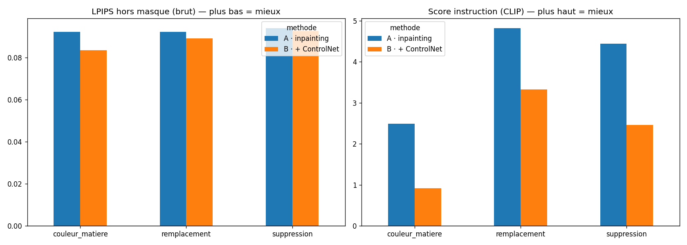

# Édition contrôlée par masques et structure

## Groupe

| Membre (pseudo GitHub) | Contribution principale |
|---|---|
| @GaetanPsx | Pipeline Colab (méthodes A et B), métriques LPIPS/CLIPScore, analyse des résultats, Sélection des images et des prompts, README, slides de soutenance|
| Martin18l | Pipeline Colab (méthodes A et B), métriques LPIPS/CLIPScore, analyse des résultats, Sélection des images et des prompts, README, slides de soutenance |

## Sujet

- **Identifiant du catalogue :** C3 — Édition contrôlée par masques et structure
- **Problématique :** modifier une zone précise d'une image sans toucher au reste de la scène, et mesurer séparément le respect de la zone, de la structure et de l'instruction.
- **MVP :** 30 couples image/masque, deux méthodes d'édition (inpainting simple et inpainting + ControlNet), visualisation avant/après, métriques LPIPS hors masque et CLIPScore dans le masque.

## Architecture

```text
COCO val2017 ──► sélection auto (objet = 10–30 % de l'image, seul de sa catégorie)
     │
     ├─► image redimensionnée (côté max 512 px)
     └─► masque (polygone COCO → blanc = zone à modifier, dilaté de 8 px)
                     │
        prompt ──────┼──────────────────────────────┐
                     ▼                              ▼
     Méthode A : SD 1.5 inpainting        Méthode B : SD 1.5 inpainting
                                          + ControlNet Canny (contours de l'original)
                     │                              │
                     └──► recollage de l'original hors masque ◄──┘
                                       │
                ┌──────────────────────┴──────────────────────┐
                ▼                                             ▼
     LPIPS hors masque (AlexNet)                 CLIPScore dans le masque (CLIP ViT-B/32)
     « le reste est-il intact ? »                « l'instruction est-elle suivie ? »
```

- **Données :** 30 images COCO val2017, choisies automatiquement avec une graine fixe (reproductible). 3 types d'édition × 10 images : `couleur_matiere` (même objet, autre couleur/matière), `remplacement` (autre objet), `suppression` (l'objet disparaît).
- **Méthode A (baseline) :** `stable-diffusion-v1-5/stable-diffusion-inpainting`. La zone masquée est remplacée par du bruit, puis débruitée en 30 étapes guidées par le prompt.
- **Méthode B :** même modèle, même graine, même prompt, plus `lllyasviel/control_v11p_sd15_canny`. Une carte des contours (Canny) de l'image d'origine contraint la génération à suivre la structure de la scène.
- **Recollage :** la sortie du modèle (« brute ») altère légèrement toute l'image (passage par l'espace latent) ; on recolle donc l'original hors du masque pour obtenir l'image finale.
- **Exécution :** Google Colab, GPU T4, bibliothèque `diffusers`. Aucune API payante (coût : 0 €).

## Installation

1. Ouvrir `notebooks/edition_masques_etape3_30images.ipynb` dans [Google Colab](https://colab.research.google.com) (*Fichier > Importer un notebook*).
2. Activer le GPU : *Exécution > Modifier le type d'exécution > GPU T4*.

La première cellule installe les dépendances (`diffusers`, `transformers`, `accelerate`, `pycocotools`, `lpips`) et désinstalle `torchao` (version préinstallée sur Colab incompatible avec `diffusers` récent). Aucune clé d'API n'est nécessaire ; `.env.example` ne contient qu'un `HF_TOKEN` optionnel.

## Utilisation

Exécuter les sections du notebook dans l'ordre :

| Section | Rôle |
|---|---|
| 0–1 | Installation et paramètres |
| 2–4 | Plan d'expérience, sélection des 30 images COCO, préparation des masques, aperçu |
| 5–7 | Chargement des modèles, boucle A + B + métriques (environ 15–25 min sur T4) |
| 8 | Bilan : tableaux et graphiques |
| 9 | Téléchargement des résultats |

La boucle sauvegarde chaque résultat au fur et à mesure : en cas de déconnexion de Colab, il suffit de relancer, et les images déjà traitées sont sautées.

## Tests

Pas de tests automatisés. Vérifications intégrées au notebook :

- aperçu des 30 images et masques avant génération ;
- détection des images noires (filtre de sécurité du modèle) et relance avec une autre graine (1 relance sur 60 générations) ;
- gestion des erreurs : une image qui échoue n'arrête pas la boucle ;
- contrôle de cohérence : LPIPS hors masque après recollage proche de 0.

## Résultats et évaluation


| Méthode | LPIPS hors masque (final) | LPIPS hors masque (brut) | Score d'instruction |
|---|---|---|---|
| A · inpainting | 0,017 | 0,093 | **3,91** |
| B · + ControlNet | 0,012 | **0,089** | 2,24 |

| Type d'édition | LPIPS brut A | LPIPS brut B | Instruction A | Instruction B |
|---|---|---|---|---|
| couleur / matière | 0,092 | **0,084** | **2,49** | 0,92 |
| remplacement | 0,092 | **0,089** | **4,82** | 3,33 |
| suppression | 0,094 | **0,093** | **4,44** | 2,46 |




## Limites et plan B

- **Pas de notation humaine aveugle** : la structure (forme, perspective) n'est pas mesurée séparément ; seules la préservation de la zone (LPIPS) et l'instruction (CLIP) le sont.
- **CLIP se trompe parfois**, surtout sur les suppressions : pour la bouteille (image 21), A l'a correctement effacée, mais le score pour « a bottle » a augmenté.
- **Écarts faibles et variance élevée** (écart-type du score d'instruction ≈ 3–5 pour une moyenne de 2–4) : avec 10 images par type et une seule graine, ce sont des tendances, pas des résultats significatifs.
- **Carte Canny souvent trop chargée** (feuillages, textures) : elle sur-contraint la méthode B (grain, textures recopiées).
- **Un seul réglage testé** (force ControlNet = 0,8, seuils Canny 100/200).
- **Plan B :** les résultats précalculés (métriques, graphiques, comparaisons) sont dans `resultats/` et peuvent être présentés sans GPU.

## Répartition du travail

Pipeline Colab (méthodes A et B), métriques LPIPS/CLIPScore, analyse des résultats, Sélection des images et des prompts, README, slides de soutenance

## Licence et références

- Code : licence MIT
- Modèles : [Stable Diffusion v1.5 inpainting](https://huggingface.co/stable-diffusion-v1-5/stable-diffusion-inpainting) (CreativeML OpenRAIL-M), [ControlNet v1.1 Canny](https://huggingface.co/lllyasviel/control_v11p_sd15_canny) (OpenRAIL), [CLIP ViT-B/32](https://huggingface.co/openai/clip-vit-base-patch32) (MIT), [LPIPS](https://github.com/richzhang/PerceptualSimilarity) (BSD-2).
- Données : [COCO 2017](https://cocodataset.org) — annotations sous CC BY 4.0, images Flickr sous leurs licences respectives.
- Références : Rombach et al., *High-Resolution Image Synthesis with Latent Diffusion Models* (2022) · Zhang et al., *Adding Conditional Control to Text-to-Image Diffusion Models* (ControlNet, 2023) · Zhang et al., *The Unreasonable Effectiveness of Deep Features as a Perceptual Metric* (LPIPS, 2018) · Hessel et al., *CLIPScore* (2021).